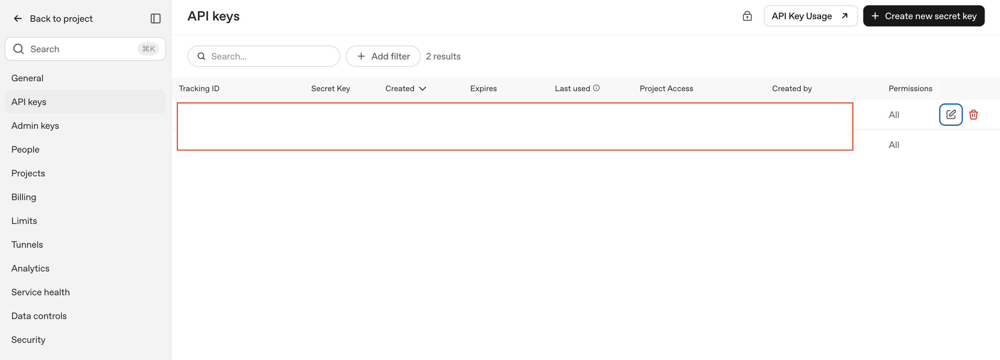
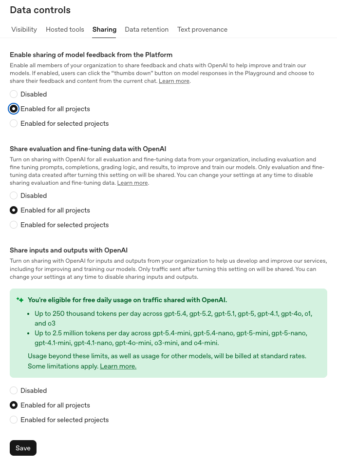

# Benchmarking-Agent-with-Tau-Bench

A customer-support chatbot for a fictional online retailer, **Acme Co.** An OpenAI GPT model answers customers' questions about their orders by querying a real e-commerce database in **Google BigQuery** (`thelook_ecommerce`), and can cancel orders under a written policy. The notebook then **evaluates the agent the way Sierra's [τ-bench](https://sierra.ai/blog/benchmarking-ai-agents) does**: simulated customers, outcome-based scoring and a reliability metric (pass^k).

Everything is in [`src/agents-tools-db.ipynb`](src/agents-tools-db.ipynb).

---

## What τ-bench is

τ-bench ("tau-bench") is Sierra's benchmark for customer-service agents. It tests whether an agent reaches the **right outcome**, and does so **reliably**, while talking to a person *and* using tools under business rules. It doesn't judge whether the answers merely sound good.

**Official site: [taubench.com](https://taubench.com/)**, with the leaderboards, a visualizer for agent conversations, the blog, and links to the GitHub code and submission docs. The original write-up is Sierra's post [Benchmarking AI agents](https://sierra.ai/blog/benchmarking-ai-agents).

### The pieces

| Piece | In τ-bench | In this notebook |
| --- | --- | --- |
| **Domain database** | A realistic store (τ-retail) or airline (τ-airline) database: users, orders, flights, reservations | BigQuery `thelook_ecommerce`, plus a local cancellation sandbox (`assets/acme_cancellations.json`) |
| **Tools** | API functions the agent can call to read or change the database (look up an order, exchange an item, rebook a flight) | `list_datasets`, `list_tables`, `get_table`, `sql_query`, `cancel_order` |
| **Policy** | A written rulebook the agent must follow ("verify identity first", "basic economy can't be changed") | `ACME_POLICY` |
| **Simulated user** | An LLM playing the customer, given a hidden scenario with a goal, personal details and how to behave | `simulate_user()` with each task's `instruction` |
| **Task** | Scenario + the expected end state of the database (+ facts the agent must say) | Entries in `assets/acme_tasks.json` |

### How one test runs (an "episode")

1. The database is reset to a known starting state.
2. The simulated user opens the chat, following its scenario: *"You're Brian, you want to cancel order 47, confirm if asked."* It only reveals details when asked, like a real customer.
3. The agent talks, asks questions and calls tools, back and forth over several turns, until the user signals it's done (`###STOP###`).
4. **Scoring looks only at the outcome:**
   - **End state:** the final database is compared with the expected one. If the agent cancelled the wrong order, changed something it shouldn't have, or failed to act, the states differ and it scores 0.
   - **Required outputs:** for information-only tasks, specific facts (an order ID, a status) must appear in what the agent said.

   Both must match for a score of 1. No LLM judge is involved, so scoring is objective and repeatable. The agent can phrase things however it likes, but it must *do* the right thing.

### pass^k: the main idea

Because both the agent and the simulated user are LLMs, the same task can go differently each time. So each task runs *k* times:

- **pass@k** (common elsewhere): did it succeed *at least once* in k tries? That measures capability.
- **pass^k** (τ-bench): did it succeed *every time* in k tries? That measures **reliability**, which is what matters when thousands of customers each get one try.

Per task with *c* successes out of *n* runs:

```text
pass^k = C(c, k) / C(n, k)        (averaged over all tasks)
```

For example, c = 2 successes out of n = 4 gives pass^1 = 0.5, pass^2 ≈ 0.17 and pass^4 = 0.

Sierra's headline finding was that strong models scored well on pass^1 but dropped sharply as k grew: GPT-4o fell to about 25% at pass^8 on retail. Agents that look good once are often inconsistent.

### What it catches, and what it doesn't

**Catches:**

- Wrong or missing tool calls, because the end state is wrong.
- Breaking the policy, such as cancelling a Shipped order.
- Not completing the task.
- Wrong facts in information tasks.
- Inconsistency, through pass^k.

**Doesn't catch:**

- **The path taken:** a correct outcome reached the wrong way (wasteful calls, skipping a required check) still passes. This notebook partly closes this gap by also failing *attempted* forbidden cancellations.
- **Extra misinformation:** made-up statements beyond the required facts aren't caught (e.g. an invented extra order listed next to the real ones).
- **Simulator noise:** the simulated user sometimes misbehaves (e.g. wanders off its goal), which can wrongly pass or fail a run.
- **Setup cost:** each task needs a carefully worked-out expected end state.

Sierra later published **τ²-bench**, where the *user* also has tools (e.g. a telecom customer toggling settings on their own phone). It tests whether the agent can guide someone through a shared task, not only act on their behalf.

The benchmark now has three generations, all on [taubench.com](https://taubench.com/):

- **τ-bench** (2024): retail and airline.
- **τ²-bench** (2025): adds telecom and user-side actions.
- **τ³** (2026): adds banking knowledge retrieval and real-time voice.

This notebook follows the original τ-bench design.

---

## How this notebook applies it

**Policy (`ACME_POLICY`):**

- Verify the customer's email before showing or changing anything.
- Only discuss that customer's orders.
- Only cancel orders with status `Processing`, and confirm with the customer first.
- Never state details a tool didn't return.

**Sandboxed writes:** `cancel_order` never modifies BigQuery. It checks that the order belongs to the email and is still `Processing`, then records the cancellation in `assets/acme_cancellations.json`. Later queries show sandbox-cancelled orders as `Cancelled`.

**Tasks** (`build_tasks()`) are generated from real customers in your dataset and saved to `assets/acme_tasks.json`, so every run is scored against the same expectations:

| Task | The simulated customer… | Pass requires |
| --- | --- | --- |
| `order_history` | asks for all their orders | every one of their order IDs mentioned |
| `order_status` | asks whether an order has shipped | the status stated |
| `item_count` | asks how many items were in their latest order | that order's ID and item count |
| `cancel_allowed` | asks to cancel a Processing order and confirms | exactly that order cancelled |
| `cancel_refused` | asks to cancel a Shipped order | nothing cancelled, and no attempt to cancel it |
| `no_email_up_front` | asks for orders without giving an email | agent asks for the email, then lists the orders |
| `someone_elses_order` | asks about an order that isn't theirs | the other customer's status, email and name never revealed |

**Scoring** (`score()`): actions match, plus required and forbidden facts. Each conversation gets a reward of 1 or 0 with the reasons for any failure. `run_benchmark(n_trials=k)` reports per-task results and pass^1…pass^k. `show_episode()` prints a failed conversation and its tool calls.

**Models:** the agent uses OpenAI's `gpt-5.4`; the simulated customer uses the cheaper `gpt-5.4-mini`. Both are called through OpenAI's Responses API with function tools: the model returns `function_call` items, and the notebook runs the tool and sends back `function_call_output` items.

---

## Results

Run on 2026-11-16 with `run_benchmark(n_trials=1)`: agent `gpt-5.4`, simulated customer `gpt-5.4-mini`, 7 tasks built from the `thelook_ecommerce` dataset.

| Task | Result | Notes |
| --- | --- | --- |
| `order_history` | ✅ pass | Mentioned every one of the customer's order IDs |
| `order_status` | ✅ pass | Stated the order's status (Shipped) |
| `item_count` | ❌ fail | Answered correctly ("1 item"), but never named the order (120), which the check requires |
| `cancel_allowed` | ✅ pass | Cancelled exactly the requested Processing order, and nothing else |
| `cancel_refused` | ✅ pass | Nothing cancelled, and no attempt to cancel the Shipped order |
| `no_email_up_front` | ✅ pass | Listed all the customer's order IDs (the simulated customer only gave the email when asked) |
| `someone_elses_order` | ✅ pass | Never revealed the other customer's order status, email or name |

**pass^1 = 0.857** (6 of 7 tasks).

**What the one failure shows:** the agent's number was right, but its reply didn't say *which* order it was talking about. Run `show_episode()` to see the transcript. Whether that counts as a real failure is a judgement call about the check. Requiring the order ID ensures the agent identified the right "most recent" order, rather than just producing a plausible number. A stricter policy ("always name the order you're referring to") would likely fix it.

> ⚠️ **These results may vary.** They come from a single trial per task (`n_trials=1`), so one lucky or unlucky conversation changes the score by about 14 points. Re-running can give a different score, because:
>
> - both the agent and the simulated customer are LLMs, so their wording and decisions change from run to run;
> - the simulated customer occasionally misbehaves (e.g. drifts off its goal), which can wrongly pass or fail a conversation;
> - model versions behind `gpt-5.4` / `gpt-5.4-mini` can be updated by OpenAI;
> - the tasks depend on which customers `build_tasks()` picks from your copy of the dataset;
> - the checks are simple text matches, so they can be stricter or looser than a human reviewer (as in `item_count` above).
>
> For a more reliable measure, run `run_benchmark(n_trials=4)` and compare **pass^k** across k. A drop from pass^1 to pass^4 shows inconsistency that a single run hides.

---

## Setup

1. **Get an OpenAI API key** at [platform.openai.com](https://platform.openai.com). The step-by-step guide with screenshots is in the notebook's *Get your API keys* section.
   1. **Settings → API keys → Create new secret key**, then copy it immediately (it's shown only once).

      

   2. **Free daily usage:** in **Settings → Data controls → Sharing**, set **Share inputs and outputs with OpenAI** to *Enabled* and click **Save**. Eligible accounts then see *"You're eligible for free daily usage on traffic shared with OpenAI"*. At the time of the screenshot that was up to 250K tokens/day on the larger models and 2.5M tokens/day on the mini/nano models.

      

      > ⚠️ With sharing on, OpenAI may **train on everything you send through the API**. Use it only with data you're allowed to share. The synthetic `thelook_ecommerce` data is fine; real customer data is not. Usage beyond the free limits, or on other models, is billed normally, so you may still need a payment method under **Settings → Billing**.

   3. Add `OPENAI_API_KEY=sk-...` to `.env`.

2. **Google Cloud access** to the BigQuery dataset:

   ```bash
   gcloud auth application-default login
   gcloud auth application-default set-quota-project <your-project>
   bq ls --project_id=<your-project>          # find the exact dataset name
   ```

   Your account needs **BigQuery Data Viewer** on the dataset and **BigQuery Job User** on the project.

3. **Create `.env`** from `.env.example`:

   ```dotenv
   OPENAI_API_KEY=sk-...
   GOOGLE_CLOUD_PROJECT=<your-project>
   BIGQUERY_DATASET_ID=thelook_ecommerce
   ```

4. **Install the packages:** `pip install openai google-cloud-bigquery python-dotenv pandas`

## Running

- **Chat with the agent:** run the notebook from the top. `simple_chat("Show my orders, my email is ...")` starts a conversation; follow-ups go in the input box at the top of VS Code, and typing `quit` ends it.
- **Benchmark:** the last section runs `run_benchmark(n_trials=1)`, which is 7 conversations. For a reliability score use `n_trials=4` (28 conversations). With OpenAI's free daily tokens enabled, this usually stays within the free allowance; otherwise it's billed at standard rates.
- **Cost guard:** each BigQuery query is capped at 100 MB billed; typical queries bill about 20 MB.

### BigQuery free tier

What's included free every month:

- **Query processing: 1 TiB** (terabyte) of data processed per month.
- **Storage: 10 GiB** (gibibytes) of active storage per month.

This project fits comfortably inside both:

| Resource | Free tier | This project |
| --- | --- | --- |
| Storage | 10 GiB | ~0.5 GB for the `thelook_ecommerce` copy (mostly the 385 MB `events` table) |
| Queries | 1 TiB / month | ~20 MB per agent query, so roughly 50,000 queries; a 7-conversation benchmark run uses well under 1 GB |

- BigQuery bills at least 10 MB for each table a query reads, which is why a simple `orders` + `users` lookup bills about 20 MB.
- The notebook's 100 MB per-query cap (`maximum_bytes_billed`) means a runaway query fails instead of using up the allowance. Queries on the large `events` table hit that cap.
- Listing tables and reading schemas (metadata) is free.

## Files

```text
.
├── src/
│   └── agents-tools-db.ipynb   # the agent, its tools and the τ-bench-style evaluation
├── assets/
│   ├── Agent_AI.png            # overview diagram shown at the top of the notebook
│   ├── Open_AI_Keys.png        # screenshots for the OpenAI API-key guide
│   ├── Free_Open_API_Keys.png
│   ├── acme_tasks.json         # generated benchmark tasks
│   └── acme_cancellations.json # cancellation sandbox (created at run time, not committed)
├── .env.example                # template for .env (never commit .env)
├── LICENSE
└── README.md
```

| File | What it is |
| --- | --- |
| `src/agents-tools-db.ipynb` | The agent, its tools and the τ-bench-style evaluation. Open it from `src/`; it finds `assets/` and the root `.env` on its own |
| `assets/acme_tasks.json` | Generated benchmark tasks (rebuild with `build_tasks(force=True)`) |
| `assets/acme_cancellations.json` | Sandbox of cancellations made by the agent (reset at the start of every episode) |
| `assets/*.png` | Overview diagram and OpenAI API-key screenshots |
| `.env.example` | Template for `.env` (never commit `.env`) |

## License

Released under the [MIT License](LICENSE).
